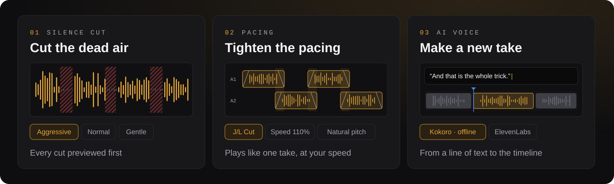
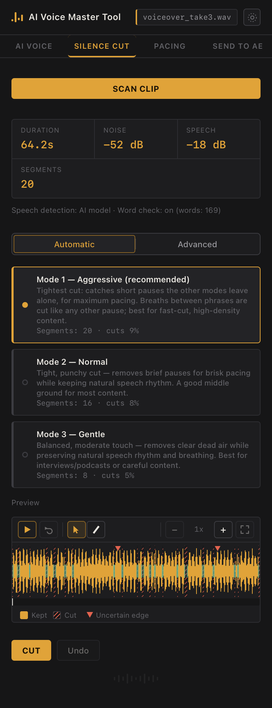
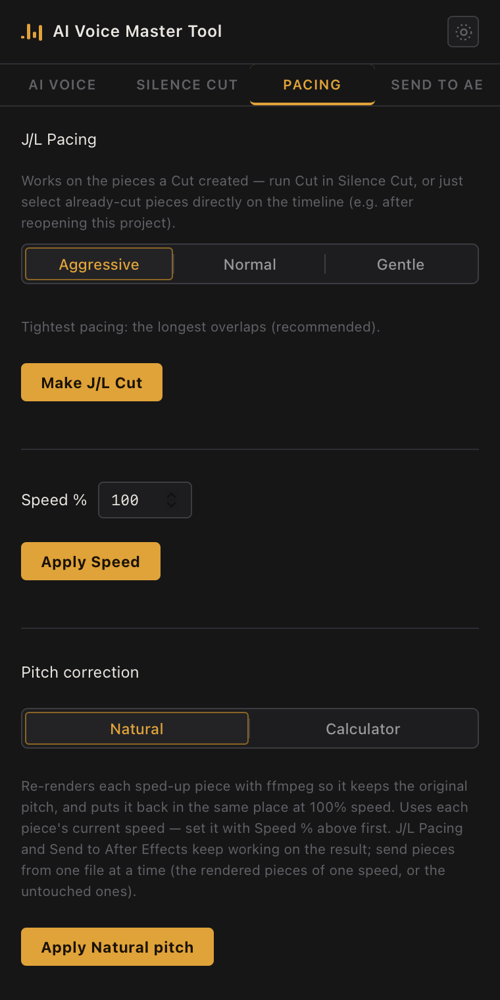
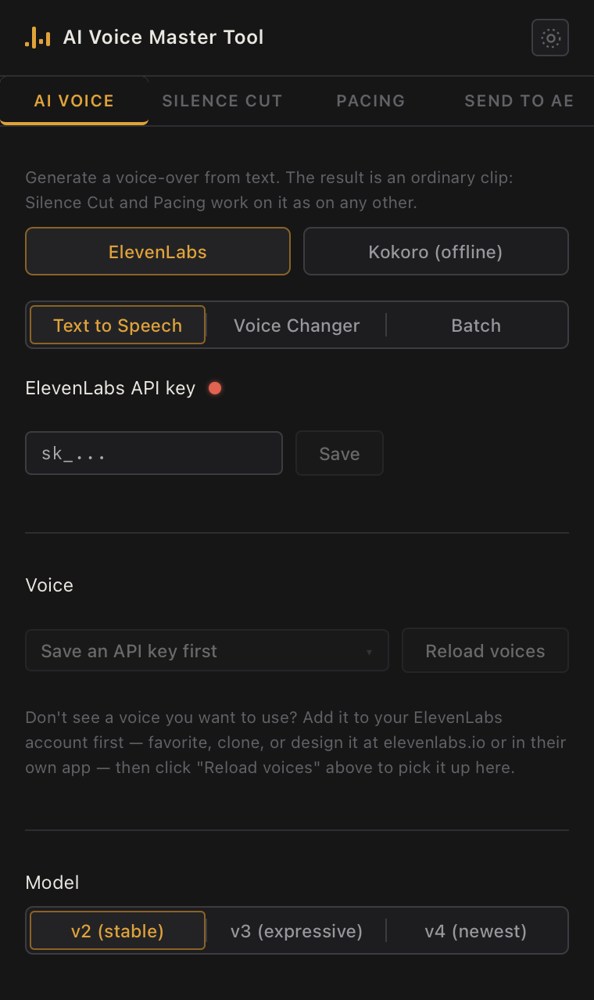

<h1 align="center">
   
  AI Voice Master Tool
</h1>

  <b>Cut the dead air out of a voice-over, tighten its pacing and make new takes, without leaving Premiere Pro.</b>

  
  
  
  
  
  
  

  

  Finding the pauses is an estimate: check the preview, and switch any cut off with one click. 
  User guide:
  <a href="docs/USER-GUIDE.md">English</a> &middot;
  <a href="docs/USER-GUIDE.ru.md">Russian</a> &middot;
  <a href="docs/USER-GUIDE.es.md">Spanish</a> 
  <a href="#install">Install</a> &middot; <a href="#known-limits">Known limits</a> &middot; <a href="docs/TROUBLESHOOTING.md">Troubleshooting</a>

  <picture>
    <source media="(max-width: 600px)" srcset="docs/images/hero-phone.svg">
    
  </picture>

## What it's for

AI Voice Master Tool is a Premiere Pro plugin for cleaning up a recorded voice-over. If the edit continues in After Effects, **Send to After Effects** passes the pieces there as layers. The interface is in English, Russian and Spanish.

- Silence Cut finds the pauses in a voice clip and cuts them out in one click. A waveform preview shows every cut first, and you can switch any of them off.
- J/L Pacing starts each piece just under the end of the one before, with short fades, so the joins don't show. If you then speed the voice up, Natural pitch brings it back to its own pitch.
- AI Voice turns a line you type into a new take, free and offline with Kokoro or through your ElevenLabs account. The take goes in without overwriting a clip.

A typical pass: Scan, check the preview, Cut, Make J/L Cut, set the Speed, fix the pitch, and Send to After Effects if the edit continues there.

### By hand and with the plugin

| | By hand | With the plugin |
|---|---|---|
| Find the pauses | Scrub and mark every gap | Scan; preview every cut |
| Cut them out | Razor and ripple-delete each gap | One click, with Undo |
| Choppy joins | Overlap on two tracks, fade by hand | Make J/L Cut overlaps and fades |
| Faster voice sounds higher | Maintain Audio Pitch or Pitch Shifter, per clip | Natural re-renders at the original pitch |
| A missing line | Record it again | Type it; it lands at the playhead |
| A different voice | Find another speaker | Voice Changer (ElevenLabs) |
| Finish in After Effects | Rebuild the cut layer by layer | Send to After Effects, as layers |

Everything runs on your computer, except the cloud features you turn on by entering your own key. The plugin never changes your source files.

## Features

  
  

### Silence Cut

- **Scan** works on your computer. A voice-detection model finds where speech starts and stops, and a speech-to-text pass keeps cuts out of words. After Scan, the plugin shows whether this word check ran.
- Pick a preset (Aggressive, Normal or Gentle), or set your own threshold and minimum pause, which you can save under a name.
- The waveform preview shows the result before anything changes: amber is kept, hatched is cut, and a red triangle marks an edge worth a listen. In Edit mode, click a region to flip it or drag its edge to move it.
- **Cut** rebuilds the clip from the kept pieces. **Undo** puts the uncut clip back. It is off after J/L Pacing, until **Reset** puts every piece back in a row.

### Pacing: J/L, Speed and Pitch

- **J/L Pacing** puts the pieces on two alternating tracks and starts each one under the end of the one before. The overlap is measured from the quiet audio at each boundary, and Aggressive and Normal add a small minimum overlap on clean voice. Every edge gets a short fade against clicks. **Reset** puts the pieces back in a row.
- **Speed** speeds the pieces up or slows them down and keeps the J/L overlaps in step.
- **Pitch correction** undoes the pitch change that comes with the speed change. **Natural** (the default) re-renders each piece at its original pitch and puts it back at 100% speed, and **Revert** brings the original pieces back. **Calculator** shows the semitones, cents and ratio to type into a pitch plugin of your own.
- **Render full timeline for AE** bakes Premiere effects, such as an EQ or a pitch effect you added by hand, into one audio file, so the effects reach After Effects. Pieces made by Natural don't need it.

### AI Voice

  

- Kokoro is free and runs offline, with English (American and British), Spanish, French, Italian, Hindi and Brazilian Portuguese voices.
- ElevenLabs works with your own account: the v2, v3 and v4 models, your own and stock voices, **Voice Changer** (same words, another voice) and **Batch** (one clip per line of text).
- **Improve for voice** is optional. It polishes the script for spoken delivery, using your own OpenAI or Anthropic key.
- **Generate & Insert** puts the take at the playhead and never overwrites a clip. **Replace Voice** puts the new take on the track below and disables the old one, so you can bring it back.

### Send to After Effects

**Send to After Effects** passes the selected pieces to the **AI Voice Master Tool Bridge** plugin in After Effects. The Bridge places them in the current composition as layers linked to your original media, with their speed and J/L positions. The layers climb like a staircase, with the first piece at the bottom.

<b>A typical session, step by step</b>

1. Select the voice clip and press **Scan** on the Silence Cut tab.
2. Check the preview: listen to the spots with a red marker, switch cuts on or off.
3. Press **Cut**. The new pieces stay selected.
4. On the Pacing tab, press **Make J/L Cut**, then change the **Speed** if you want.
5. Fix the pitch: **Apply Natural pitch**.
6. If the edit continues in After Effects: **Send to After Effects** on the Send to AE tab.

## Install

You need Premiere Pro 2025 or later (on a Mac, macOS 13 Ventura or later), and After Effects 2025 or later for Send to After Effects.

1. Download the package for your system with the buttons above, or from [Releases](https://github.com/ominousopera/AIVoiceMasterTool/releases): `AI-Voice-Master-Tool-macOS.zxp` or `AI-Voice-Master-Tool-Windows.zxp`.
2. Install it with a ZXP installer, for example the free [ZXP/UXP Installer](https://aescripts.com/learn/zxp-installer/). Restart Premiere Pro (and After Effects, for Send to After Effects), then open **Window → Extensions → AI Voice Master Tool**, and **AI Voice Master Tool Bridge** in After Effects.

The packages are signed, so a normal install needs no `PlayerDebugMode` and nothing typed in Terminal. If the plugin does not appear, or Scan fails on a managed Mac, see [Troubleshooting](docs/TROUBLESHOOTING.md).

To remove it, first click the gear icon → **Clear all data**. That deletes your saved API keys, your settings and the plugin's files in `Documents/AI Voice Master Tool` (files saved next to a project stay). Then delete the `com.aivoicemastertool.pro` folder from the CEP extensions folder your installer used (usually `~/Library/Application Support/Adobe/CEP/extensions` on macOS, `%APPDATA%\Adobe\CEP\extensions` on Windows) and restart.

What changed in each version is in [CHANGELOG.md](CHANGELOG.md).

<b>Privacy and security</b>

Everything runs on your computer except the optional cloud features of the AI Voice tab, and those work only after you enter your own key:

- ElevenLabs text-to-speech and Improve for voice send your text.
- Voice Changer uploads the selected clip's audio to ElevenLabs.
- With a key saved, the plugin loads your voice list from ElevenLabs, and the list of models from OpenAI or Anthropic (the provider selected for Improve for voice), each time it opens.

Calls go straight from your computer to that provider. There is no telemetry, analytics or update check. The code enforces this: the plugin refuses every other web request ([`networkGuard.ts`](src/js/lib/networkGuard.ts)), loads no Node.js networking module and opens no debugging ports, and the bundled FFmpeg is built without network support. Report a vulnerability privately through the repository's Security tab; see [`SECURITY.md`](SECURITY.md).

## Known limits

Finding the pauses is automatic, so check the result by ear. Listen to the preview before you press Cut, above all at the red markers, and switch off any cut that sounds wrong.

- Scan takes one clip at a time. Scan and Natural pitch work with mono and stereo files; Scan hears a stereo file as one mix.
- Scan and Natural pitch read the audio of the common files Premiere Pro imports: WAV and BWF, AIFF, MP3, AAC and M4A (also Apple Lossless), and the AAC, PCM, AC-3, MP2/MP3 or WMA audio in MOV, MP4, MXF, AVI, MTS/M2TS, MPG/VOB, MKV and WMV files. For audio in another format, such as FLAC, Opus or ADPCM, export the voice as a WAV file first (File → Export → Media, Format: Waveform Audio).
- Scan and Natural pitch refuse a file with more than two channels, or one with its channels as separate audio tracks (common in camera files). Export the voice as a mono file first (File → Export → Media, Audio → Channels: Mono).
- Scan and Natural pitch refuse a clip that shows up on the timeline as linked audio clips on two or more tracks. Alt/Option-click the channel you don't need and delete it; the clip stays linked to its video. Both then use the file's full mix, so if that channel carries other sound, use the mono export instead (for pitch, a pitch plugin with the values from Calculator also works).
- Add effects last. Undo, J/L Pacing, Reset and Speed right after Cut place the pieces again from the source file, so effects, volume changes and keyframes on them are lost. The plugin lists what would be lost and asks first.
- The plugin's Undo and Revert remember only the last operation. A new Scan clears Cut's Undo and Natural pitch's Revert. A new Cut clears Natural pitch's Revert and Revert to segments (the undo for Render full timeline for AE). The AI Voice tab's Undo is kept through both. Reopening the plugin or restarting Premiere clears all of them. Cut's Undo is off once J/L Pacing has run, until Reset puts every piece of that Cut back. Premiere's own Cmd/Ctrl+Z always works, one step at a time.
- AI voices sped up by more than about 5% can pick up artifacts. Natural usually sounds cleaner than Premiere's Pitch Shifter effect.
- In After Effects, J/L overlaps play at full volume, without a crossfade. Premiere effects on the pieces don't carry over, so bake them first with Render full timeline for AE. Pieces made by Natural go as they are.
- Render full timeline for AE and Voice Changer render inside Premiere, which stays busy until the render is done (seconds for a voice-over). If Premiere can't do it, the render goes to Adobe Media Encoder, which then has to be installed.
- Voice Changer takes clips up to 5 minutes long, which is ElevenLabs' limit. Cut a longer clip into parts.
- Cloud services (ElevenLabs, OpenAI, Anthropic) need your own account and API key, and they bill your usage there.
- On Windows, Scan's word check and Kokoro may not work if the name of your user folder (`C:\Users\…`) has letters that Windows' language for non-Unicode programs doesn't include, for example Cyrillic letters on an English Windows. The tools they run can't open files in such a folder. Scan still works, without the word check.

## FAQ

### Background

<b>What is a J/L cut, and why use one on a voice-over?</b>

J and L cuts are editing terms for sound that overlaps a cut: the next sound starts early, or the last one runs on. Between voice pieces this hides the join. Each piece starts just under the end of the one before, with a short fade, so the line plays like one take.

<b>Why does a sped-up voice sound higher?</b>

Speeding a clip up plays its sound faster, and that raises the pitch, like a record played too fast. Pitch correction brings it back: Natural re-renders each piece at its original pitch, and Calculator gives the values for a pitch plugin of your own.

### Using it

<b>Does my audio leave the computer?</b>

Only with Voice Changer, which uploads the selected clip to ElevenLabs. Text-to-speech and Improve for voice send text, never audio. Scan, Cut and Natural pitch run on your computer.

<b>What does it cost?</b>

The plugin is free software. Kokoro is free and runs offline; ElevenLabs, OpenAI and Anthropic bill their own usage on your account.

<b>Does it change my source files?</b>

No. It edits the timeline and writes new files to `Documents/AI Voice Master Tool`. Renders and generated voice-over can go next to your project instead (gear icon → Save Renders); Diagnostics reports always stay in Documents.

<b>Can I undo what it did?</b>

Yes: Cut's Undo, Revert on Natural and on Render full timeline for AE, Undo on AI Voice, and Premiere's own Cmd/Ctrl+Z.

<b>Can I use my own pitch plugin?</b>

Yes. Pitch correction's Calculator shows the semitones to type into it.

<b>Something went wrong. What do I send?</b>

Gear icon → **Run Diagnostics** writes a plain-text report to `Documents/AI Voice Master Tool/Diagnostics/`. The Bridge plugin in After Effects has the same button and saves its report to `Documents/AI Voice Master Tool/Bridge Diagnostics/`. Open the report and paste its text into a [bug report](https://github.com/ominousopera/AIVoiceMasterTool/issues/new/choose) (attach the file if it is too long); it contains no API keys, and your home folder is shortened to `~`. Read it first: it lists clip, sequence and file names.

## For developers

- Building from source: [docs/BUILDING.md](docs/BUILDING.md)
- How it works and how the code is organised: [docs/ARCHITECTURE.md](docs/ARCHITECTURE.md)
- Contributing: [CONTRIBUTING.md](CONTRIBUTING.md)
- Reporting a security problem: [SECURITY.md](SECURITY.md)

## Thanks

Special thanks to **Vladislav Baranov** for his ideas and hints on how to make the plugin better.

## License

AI Voice Master Tool is free software, licensed under the [GNU General Public License v3.0 or later](LICENSE). Copyright (C) 2026 Nikita Kolesov.

It bundles third-party components under their own licenses: FFmpeg (LGPL-2.1+), eSpeak NG (GPL-3.0+), whisper.cpp (MIT), Silero VAD (MIT), Kokoro (Apache-2.0), ONNX Runtime Web (MIT), Transformers.js (Apache-2.0) and others. The full list and the license texts are in [src/assets/licenses/](src/assets/licenses/); the source archives of the bundled FFmpeg and eSpeak NG (with the Sonic library built into it) are inside every package and attached to the `third-party-v1` release. To run your own build of eSpeak NG, see [docs/REPLACING-ESPEAK-NG.md](docs/REPLACING-ESPEAK-NG.md).

AI Voice Master Tool is an independent project, not affiliated with, sponsored by, or endorsed by Adobe, ElevenLabs, OpenAI or Anthropic.

Built with the help of Claude Code.

---

If it saves you time, a star helps other editors find it.
